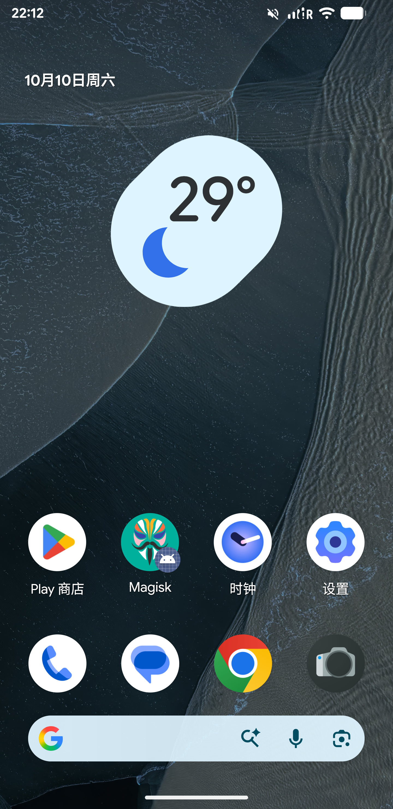
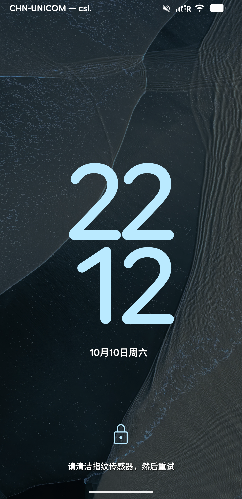
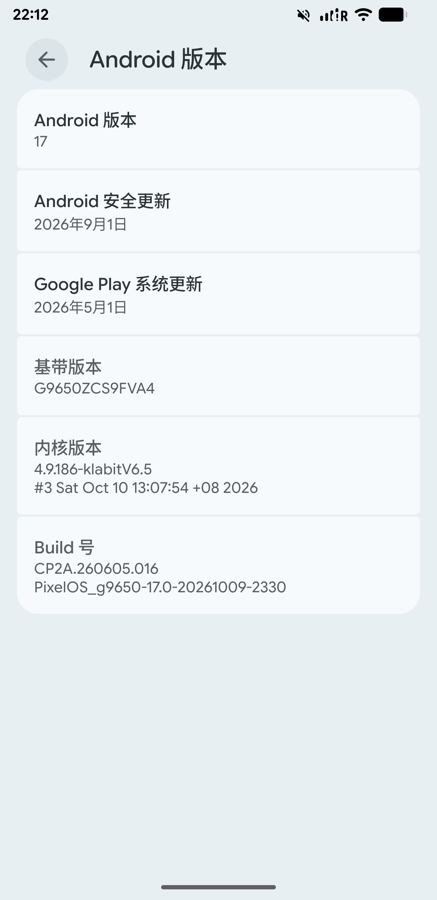
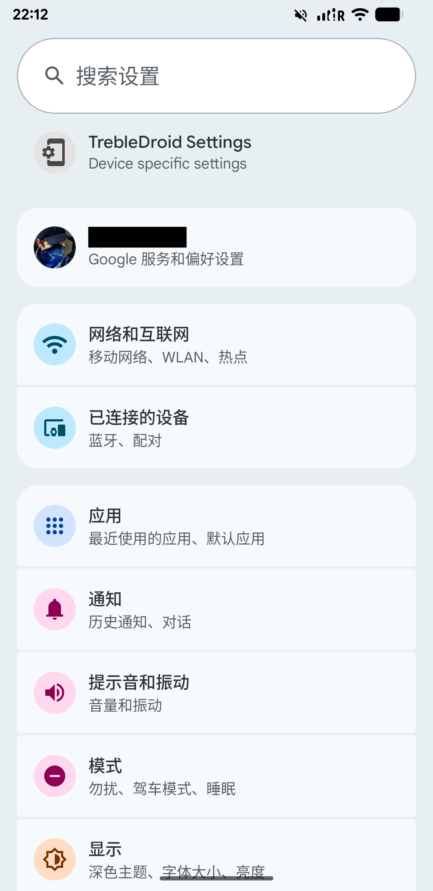

# PixelOS 17.0 (Android 17) for the Galaxy S9+ (SM-G9650)

[](https://github.com/yvanliang/pixelos17-g9650/actions/workflows/validate.yml)

An unofficial PixelOS 17 adaptation for the Snapdragon Samsung Galaxy S9+ **SM-G9650**, also known as **star2qltechn**.

The goal is to keep this older phone usable with a newer Android version while keeping the PixelOS experience. The work covers compatibility with Samsung's Android 10 vendor, the older kernel, and apps such as Chrome and WebView.

**This adaptation was carried out using AI coding agents.** It builds on the work of PixelOS, AOSP, LineageOS, TrebleDroid/PHH, AndyCGYan, and klabit87. Credit for their work stays with the original authors.

## Hardware support

The following features work with the SM-G9650 setup described below:

| Feature | Status |
| --- | --- |
| Wi-Fi | Supported |
| Bluetooth | Supported |
| Mobile network | Supported |
| Camera | Supported |
| Fingerprint reader | Supported |
| Brightness adjustment | Supported |
| Iris recognition | Not supported |

## Screenshots

| Home screen | Lock screen |
| --- | --- |
|  |  |
| **Android version** | **Settings** |
|  |  |

## Before you start

The release provides separate **SYSTEM** and **BOOT** images. BOOT contains this project's compatible kernel and ramdisk. You also need the matching FVA4 vendor, TWRP, and an unlocked bootloader.

| What you need | Tested setup |
| --- | --- |
| Phone | Samsung Galaxy S9+ **SM-G9650 / star2qltechn** |
| Firmware base | Samsung Android 10 **FVA4**; bootloader/baseband `G9650ZCS9FVA4`, CHC CSC `G9650CHC9FVA4` |
| Vendor | The matching FVA4 vendor, prepared for the existing Treble setup |
| Kernel / Boot | This project's **patched klabit V6.5 / Linux 4.9.186**, supplied as the unrooted BOOT image in the release |
| Recovery | **TWRP 3.7.0_9-0** for star2qltechn |
| Bootloader | Unlocked; keep it unlocked when using this ROM |

Other S9/S9+ variants, including G965F and G965U, have not been tested. The FVA4 vendor must already be prepared for this Treble setup; the release does not install Samsung firmware, prepare Vendor, unlock the bootloader, or install TWRP.

The compatible kernel enables the dm-verity and block-cgroup facilities used by Android, and includes the SELinux RCU and qtaguid accounting fixes used on the test phone. It still reports `4.9.186-klabitV6.5`, so the version string alone does not identify the patched build. Use the project's BOOT image for a first installation; stock Samsung Boot and the original klabit V6.5 package are not equivalent to this build. See the [kernel source and build notes](https://github.com/yvanliang/pixelos17-g9650/tree/g9650-seventeen-kernel).

## Getting the ROM

[Download PixelOS 17.0 (Android 17) for SM-G9650 — 2026-10-10](https://github.com/yvanliang/pixelos17-g9650/releases/tag/android17-g9650-20261010)

For a first installation, download both images from the release assets:

- `PixelOS-17.0-Android17-G9650-20261010-UNOFFICIAL-boot.img.xz` — the compatible, **unrooted BOOT** image; flash to **Boot**.
- `PixelOS-17.0-Android17-G9650-20261010-UNOFFICIAL-system.img.xz` — the Android 17 **SYSTEM** image; flash to **System Image**.

Extract each `.img.xz` with an XZ-capable tool to get its `.img` file. To rebuild the kernel, follow the [kernel source and build instructions](https://github.com/yvanliang/pixelos17-g9650/tree/g9650-seventeen-kernel).

This is an unofficial, experimental release for the setup described above. Existing users of this adaptation can update SYSTEM while keeping their compatible Boot and Data. You can also build SYSTEM yourself using the source instructions below.

## Build from source

Use a **Linux x86-64** machine with enough RAM and free disk space for an Android build. Start with the [official PixelOS build dependencies](https://blog.pixelos.net/docs/maintainers/guide/building-pixelos/), and install `repo`, Git LFS, and Python 3. The TrebleApp helper also needs **JDK 17**, **Android SDK platform 33**, and **build-tools 33.0.2**. Install `fsck.erofs` with EROFS extraction support for input preparation.

Start in an empty working directory. Download the adaptation tools and the pinned Android sources, then apply the patches:

```bash
git clone -b g9650-seventeen --single-branch https://github.com/yvanliang/pixelos17-g9650.git adaptation
mkdir source
cd source
repo init -u https://github.com/yvanliang/pixelos17-g9650.git \
  -b g9650-seventeen -m manifests/pinned.xml --git-lfs
repo sync -c -j8
cd ..
python3 adaptation/scripts/prepare_source.py --source source
```

Download `Camera-93.apk` from the [GrapheneOS Camera 93 release](https://github.com/GrapheneOS/Camera/releases/tag/93). Prepare the original app inputs and build the patched TrebleApp. Replace the example paths with your APK, JDK, and SDK locations:

```bash
python3 adaptation/scripts/materialize_inputs.py --source source \
  --camera-apk /path/to/Camera-93.apk

JAVA_HOME=/path/to/jdk17 ANDROID_HOME=/path/to/android-sdk \
  bash adaptation/scripts/build_treble_app.sh source
```

Keep `fsck.erofs` on your `PATH` when preparing the inputs, or pass `--fsck-erofs /path/to/fsck.erofs` to the input script.

Check the prepared sources and build SYSTEM. Adjust `--jobs` to suit your machine:

```bash
python3 adaptation/scripts/validate.py --source source
python3 adaptation/scripts/build.py --source source --result-dir artifacts --jobs 32
```

The build uses `custom_g9650-cp2a-userdebug`. Your image will be at **`source/out/target/product/tdgsi_arm64_ab/system.img`**, with the build log and result report in `artifacts/`. The `ab` in the output directory is the build target's name; the SM-G9650 still uses its existing physical partition layout.

These commands build SYSTEM only. The compatible kernel is built separately; see the [kernel build notes](https://github.com/yvanliang/pixelos17-g9650/tree/g9650-seventeen-kernel). Keep the matching FVA4 vendor and recovery described above. See the [detailed build guide](docs/BUILDING.md) for input handling.

## Flashing

### First installation from stock or another ROM

Start with the prepared FVA4 vendor, unlocked bootloader, and TWRP described above. Stay in recovery until both images are installed.

1. Extract both release images and put them on a microSD card, USB storage, or another location that will remain available after formatting Data. Boot into TWRP.
2. Choose **Install → Install Image**, select the extracted `...-boot.img`, and flash it to **Boot**.
3. **Format Data** for the first installation. This removes the previous ROM's apps, settings, and encryption state, and **erases internal storage**, including photos and downloads. A cache/Dalvik wipe alone does not do this.
4. If recovery needs to reload Data after formatting, choose **Reboot → Recovery**. Then use **Install → Install Image** to flash the extracted `...-system.img` to **System Image**.
5. Keep the prepared FVA4 Vendor and TWRP Recovery, then reboot into the system.

The tested TWRP build has shown instability while formatting Data on this device. If formatting fails or recovery crashes, stop and resolve that problem before continuing. These steps assume the firmware/vendor preparation is already complete; they do not cover the earlier Odin, bootloader, or Vendor preparation process.

### Updating this adaptation

If you already run this PixelOS adaptation with its compatible BOOT, extract the new SYSTEM image and flash it to **System Image** in TWRP. **Keep Boot, Vendor, Recovery, and Data; do not format Data.** Reboot after flashing. Reinstalling the kernel is only needed when a future release explicitly requires a BOOT update.

## Root

Root is optional and managed separately through the boot image. The release BOOT is **unrooted**. Install your chosen root tool after the first installation if you want root. Flashing the release BOOT over a Magisk-patched Boot removes that boot patch; SYSTEM-only updates keep the existing Boot.

## What to expect

The features listed above work in the current setup. This is still an experimental port; new platform and app updates need regression testing.

- SELinux currently runs in **Permissive** mode.
- The old kernel has limitations around Android's per-app network firewall and KeyMint.
- Chrome and WebView compatibility fixes are included in the platform. Future app updates still need testing.
- Banking apps, DRM, and Play Integrity may not work as expected.

## Development

This repository is a fork of the [official PixelOS manifest](https://github.com/PixelOS-AOSP/android_manifest). The `g9650-seventeen` branch adds the device adaptation, source patches, and tools needed to prepare a build.

The complete kernel source, validated configuration, and kernel build guide are maintained separately on [g9650-seventeen-kernel](https://github.com/yvanliang/pixelos17-g9650/tree/g9650-seventeen-kernel).

GitHub Actions runs source checks and checks for upstream updates. ROM builds are done manually.

- [Build from source](docs/BUILDING.md)
- [Bring in PixelOS updates](docs/UPDATING.md)
- [Downloads and installation](docs/RELEASES.md)

Please describe your exact model, firmware base, kernel, and the problem when opening an issue. Remove account information and device identifiers from logs before sharing them.

This is a community project, not an official PixelOS or Samsung release. Upstream code keeps its original licences; see [LICENSE](LICENSE) and [NOTICE](NOTICE) for the scope of this repository's own licence.
